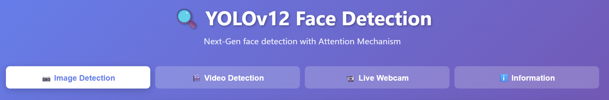
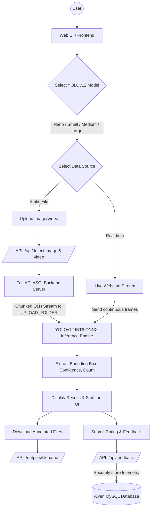

# 🔍 YOLOv12 Human Face Detection Web Application

[](https://huggingface.co/spaces/RevDra/YOLOv12_HFD)
[](LICENSE)
[](https://www.python.org/downloads/)
[](config/Dockerfile)
[](https://github.com/RevDra/human-face-detection/actions/workflows/docker-publish.yml)

<br>
<div align="center">
  
</div>
<br>

A professional, real-time high-performance face detection system built with **YOLOv12 INT8 ONNX Runtime** and **FastAPI**. Powered by an asynchronous ASGI architecture, thread-pool execution, O(1) memory chunked file uploads, and a modern browser client-side canvas rendering pipeline, this project delivers state-of-the-art accuracy with ultra-low latency and zero-PyTorch footprint.

View the demo using this [link](https://revdra-yolov12-hfd.hf.space/).

## ✨ Features

### 📷 Image & Video Detection
- Upload and detect faces in images (JPG, PNG, WEBP) and videos (MP4, AVI, MOV, MKV).
- Attention-based detection for small, distant, or occluded faces.
- Client-side direct canvas rendering with interactive bounding boxes and face gallery crops.
- Real-time Server-Sent Events (SSE) stream progress bar for video processing jobs.
- Privacy mode to automatically blur faces in the output media.

### 📹 Live Webcam
- Real-time asynchronous detection directly from your browser with adaptive webcam pacing.
- Side-by-side video feed and smooth bounding box interpolation.
- Live statistics (FPS, face count, duration).

### 📊 Feedback & Analytics
- Built-in MySQL database integration (via Aiven) to collect user ratings and feedback securely.

### 🤖 Pure INT8 ONNX Runtime Models
All models are statically quantized to INT8, achieving over ~70% reduction in file size while maintaining state-of-the-art accuracy:
- **YOLOv12 Nano** - Super Fast (~3.6 MB), best for CPU/Webcam.
- **YOLOv12 Small** - Balanced speed & accuracy (~10.1 MB).
- **YOLOv12 Medium** - High precision (~20.7 MB).
- **YOLOv12 Large** - State-of-the-art accuracy (~27.7 MB).

---

## System Business Flow



---

## 🚀 Quick Start

### Prerequisites

* Python 3.14+
* Git

### Installation

1. **Clone the repository:**

```bash
git clone [https://github.com/RevDra/human-face-detection.git](https://github.com/RevDra/human-face-detection.git)
cd human-face-detection

```

2. **Install dependencies:**

```bash
pip install -r requirements.txt

```

3. **Environment Setup (Required):**
Copy the template environment file and add your secure credentials.

```bash
cp .env.example .env

```

*Open `.env` in a text editor and update the database connection strings if needed.*

4. **Run the web server:**

#### Linux/Mac

```bash
./config/deploy.sh start

```

#### Windows

```bash
config\deploy.bat start

```

5. **Open in browser:** Navigate to `http://localhost:7860`

## 📁 Project Structure

```
Human_face_detection/
├── .github/                       # CI/CD & Automation
│   ├── ISSUE_TEMPLATE/            # Community Forms
│   ├── workflows/                 # Auto-build Docker & Semantic Release CI/CD
│   └── dependabot.yml             # Automated Dependency Updates
├── assets/                        # Project Images & Screenshots
├── config/                        # Configuration & Deployment scripts (Dockerfile, Docker-Compose)
├── models/                        # YOLOv12 ONNX Models & Training benchmarks
├── src/                           # Source Code (FastAPI ASGI + ONNX Runtime)
│   ├── web_app.py                 # FastAPI web server
│   └── face_detector.py           # YOLOv12 detection engine (OpenCV + ONNX)
├── web/                           # Frontend Assets
│   └── templates/
│       └── index.html             # Web UI
├── requirements.txt               # Python dependencies
└── README.md                      # Main documentation

```

## 🐳 Docker Support (Recommended)

You can run the application instantly using Docker.

1. **Clone the repository:**

```bash
git clone [https://github.com/RevDra/human-face-detection.git](https://github.com/RevDra/human-face-detection.git)
cd human-face-detection

```

2. **Run with Docker Compose:**

```bash
docker-compose -f config/docker-compose.yml up --build

```

3. **Access the App:**
Open `http://localhost:7860` in your browser.

## 🔧 API Endpoints

| Method | Endpoint | Description |
| --- | --- | --- |
| GET | `/` | Web interface |
| POST | `/api/detect-image` | Detect faces in uploaded image |
| POST | `/api/detect-video` | Detect faces in uploaded video (with SSE stream) |
| GET | `/api/video-stream/{job_id}` | Real-time video progress SSE stream |
| GET | `/api/models` | List available models |
| POST | `/api/feedback` | Submit user rating and comments |
| GET | `/api/health` | Health check |
| GET | `/outputs/{filename}` | Download or stream processed video files |

## 📚 References

* [Ultralytics YOLOv12](https://docs.ultralytics.com/) - YOLOv12 documentation.
* [FastAPI Documentation](https://fastapi.tiangolo.com/)
* [OpenCV Documentation](https://docs.opencv.org/)
* [YOLOv12-Face Repository](https://github.com/YapaLab/yolo-face) - Source of the models/weights.

## 🙏 Acknowledgements & Licenses

This entire project is licensed under the **AGPL-3.0** to comply with the licensing terms of the YOLO ecosystem.

## 💬 Support & Q&A

[](https://github.com/RevDra/human-face-detection/discussions)


[](https://www.buymeacoffee.com/luongminhngoc)
---

**Last Updated:** November 11, 2026 | **Status:** ✅ Production Ready
